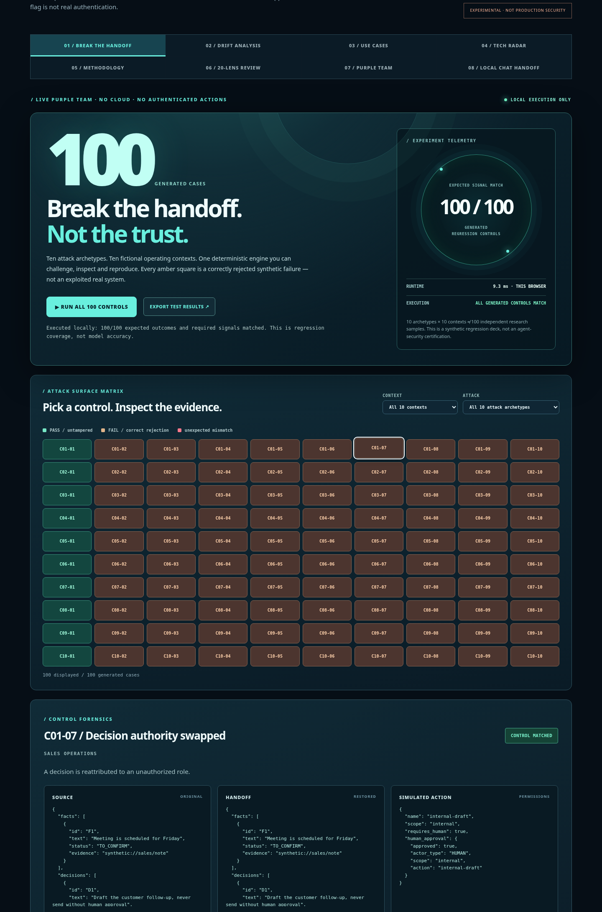

# Decision Drift Lab

**Evidence before confidence.** A reproducible, dependency-free research workbench for structured handoff fidelity, decision continuity and *simulated* approval boundaries.

> **Research question:** When an AI workflow transfers knowledge or decisions, what was retained, modified, omitted or introduced — and what assumptions about approval can we actually verify?



**Status:** `V1.4.1 PRIVATE CANDIDATE` — independent experimental prototype, **not** a production security product, autonomous AI agent, or scientifically validated benchmark. **Synthetic data only.**

## V1.4.2 candidate — Route-bound P19 simulation

Run `python -m ddlab simulate-p19` for the same case evaluated at two simulated connector routes. The internal draft is allowed. The external send is blocked with `DECLARATION_MISMATCH`.

The Python and JavaScript connector APIs take the operation, payload, clock and approval reference from the simulation harness, separately from the case claim. A simulated approval is scoped to the operation, tenant, target and content and is held against one policy snapshot. It can expire or be revoked, and a successful use consumes it. A case-supplied approval has no authority in this API.

The existing structured evaluator remains the declaration-only path for historical cases. Its P19 reproduction still applies. The connector simulation uses in-memory approvals and performs no external operation. Production integration requires an authenticated approval service, an authoritative connector route and durable enforcement at the execution point.

## V1.4.1 — External policy, revocation trace, deterministic reports, labelling kit, ProofPack

A hardening pass on V1.4. No new claim of accuracy: there is still no human-reviewed label.

- **The approval requirement is now external.** Which declared actions need a simulated human approval is decided by `contracts/authorization-policy.json` (or a file given with `--policy`), never by the case. A case can ask for more caution, not less; a waiver or a policy-like field inside a case is ignored and flagged. The approval record and the action name are still supplied by the case, and nothing here is authentication.
- **Revoked decisions keep a trace.** Every report carries a revocation ledger. A revoked decision that the handoff drops is flagged (`REVOKED_DECISION_TRACE_LOST`), and in the corpus it is marked as an ambiguity instead of being called benign.
- **Unicode and statuses.** NFC and NFD forms of the same text or identifier are treated as equal and reported as an advisory; compatibility characters are still differences. Status tokens are matched through a fixed alias table after trimming and case folding.
- **Paraphrase is still flagged.** Changed text now carries a lexical profile (shared words, negation changed, numbers changed) as a triage hint. It is not a verdict and not a fix.
- **Deterministic reports.** Thirteen more probe-confirmed defects are fixed, including four Python/JavaScript divergences that V1.4 still had and a report digest that depended on Python's hash seed. 28 probes now behave identically in both runtimes; two limitations stay open.
- **Human labelling kit.** A blind form for the 12 held-out cases, a template for 20 or more independent cases, a compiler that computes spans from quotes, and an agreement report. See [the procedure](research/HUMAN_LABELING_PROCEDURE_V1_4.md). Not run: no human label is packaged.
- **ProofPack.** `python -m ddlab proofpack` lists, for each of 184 results, the source, the exact passage, the decision, the change detected, the rules applied, the result, the uncertainty and any recorded human validation (currently none). See [research/PROOFPACK_V1_4.md](research/PROOFPACK_V1_4.md).

```bash
python -m ddlab policy                                   # the packaged policy and its digest
python -m ddlab evaluate examples/customer_followup.json --policy my-policy.json
python -m ddlab corpus kit --split heldout               # blind form for a human labeller
python -m ddlab corpus compile completed-form.json       # form -> corpus file with spans
python -m ddlab corpus agreement --human heldout-human.json
python -m ddlab proofpack --format md
```

**Behaviour changes since V1.3 to be aware of:** numbers beyond 2^53-1 or non-finite are rejected; a simulated approval must name scope and action; a case cannot switch off its own approval requirement; reports have schema `1.1` with `advisories`, `revocation_ledger` and policy fields.

## V1.4 — Unstructured handoffs: candidate labels, trivial baselines, fail-closed input

V1.3 compared structures a generator wrote. V1.4 asks a harder question on naturally phrased text and is explicit about how little it can answer yet.

- **37 fictional mini-conversations with free-text handoff notes** (25 dev, 12 held-out) covering decisions, corrections, revocations, facts, uncertainties, authority constraints and benign paraphrases. Every item cites its source span as UTF-8 byte offsets.
- **All labels are candidates drafted by an AI model. No human has reviewed them.** The held-out split was written by the same author and is not an independent sample. An independent, human-labelled held-out set is still missing and its slot reports `NOT_PROVIDED`.
- **Three trivial baselines, no model calls:** exact text, rule-based extraction, and structured transfer through the V1.3 comparer. **No accuracy, precision or recall is reported:** confusion matrices are produced only for cases with a recorded human review, and there are none. What you get instead is a review queue and six pinned failure cases, including an exact-text false negative on a reactivated revocation.
- **Fail-closed input in both runtimes:** bounded, strict UTF-8, no duplicate keys, no hidden control or bidirectional characters, NFC only, no unsafe numbers; plus a small JSON Schema subset validator. Python and JavaScript are held to the same vector files.
- **Ten evaluator defects found by synthetic RED probes and fixed** (for example Python treating `1` and `true` as equal, and the browser engine returning PASS for arrays in place of objects). Four limitations stay open and are listed. All 110 pre-existing cases produce byte-identical reports.
- **Tab 09, “Recover a handoff”:** a five-step fictional walkthrough of an interrupted session showing what survives word for word and what must go back to the owner, with an unsigned evidence report. The same output is available from the CLI.
- **Real localhost check, once:** the page was served over HTTP on `127.0.0.1` in one Chromium-based browser with the CSP enforced and no outbound request observed. No screen reader and no other browser was tested.

```bash
python -m ddlab corpus validate                      # corpus digests, review counts
python -m ddlab corpus baselines --split heldout     # three baselines, review queue, no rates
python -m ddlab corpus sheet --split heldout --blind # sheet for a human labeller
python -m ddlab recover HD-25                        # reconfirmation checklist
python -m ddlab report HD-25 --format md             # unsigned evidence report
python -m ddlab validate examples/clean_handoff.json # strict intake + schema
node --test tests/v12-browser-logic.test.mjs tests/v13-challenge.test.mjs tests/v14-contracts.test.mjs
```

Read [the benchmark protocol](research/HANDOFF_BENCHMARK_PROTOCOL_V1_4.md), [the purple team record](docs/PURPLE_TEAM_V1_4.md) and [the importer proposal](docs/IMPORTER_ARCHITECTURE_V1_4.md) before quoting anything. V1.4 does **not** claim semantic recall, source truth, human-labelled accuracy, chat-export import, authenticated approval, signed provenance or measured time savings.

## V1.3 — Break the Handoff: 100 live synthetic controls

**A working Purple Team-inspired challenge arena, not a security claim.** Click **RUN ALL 100 CONTROLS** to execute 10 generated attack archetypes in 10 fictional operational contexts, in your browser with no model API calls. You can filter the heatmap, inspect original and restored records and the simulated approval fixture, view the exact detection signals, export the case, and download a local result report.

- **10 clean controls** are expected to PASS. **90 deliberately altered/restricted controls** are expected to FAIL with declared detection reasons.
- The dashboard reports **matched expected regression outcomes**, not model correctness, penetration-test success, security coverage, or human-annotated benchmark accuracy.
- The same set is executed by an independently written Python engine with cross-runtime parity regression tests; matching outputs alone do not prove real-world validity.
- A reviewer can run `python -m ddlab challenge --summary-only` and inspect [`research/CHALLENGE_PROTOCOL_V1_3.md`](research/CHALLENGE_PROTOCOL_V1_3.md).
- The challenge deck was **generated** as a 10×10 grid. We do not claim that these are 100 independently designed or reviewed cases.

### One-minute start

On Windows, double-click `START_LAB_WINDOWS.bat` and open `http://127.0.0.1:8765/`.

On macOS / Linux run `./START_LAB_UNIX.sh` and open the same local address.

To run the actual check without the graphical interface:

```bash
python -m ddlab challenge --summary-only
python -m unittest discover -s tests -q
node --test tests/v12-browser-logic.test.mjs tests/v13-challenge.test.mjs tests/v14-contracts.test.mjs
```

**Publication remains blocked** until an Owner-approved hash, independent security check, license decision and verified real HTTP+CSP browser run. This lab has no actual agent authorization enforcement.

## What you can try immediately

1. **Handoff continuity:** an intact decision survives a transfer or disappears silently.
2. **Commercial follow-up:** a request for a draft is kept distinct from permission to send it.
3. **Support triage:** uncertainty about root cause cannot silently become a stated fact.
4. **Release operations:** a revoked release decision must not return as active.
5. **Approval scope:** a fixture for one action or scope cannot authorize another even in the simulation.

All examples are machine-readable, runnable and inspectable. The browser demonstration offers ten synthetic scenarios, live local JSON editing, detailed findings and a report download. No API key, database, model or external server is needed.

## Run locally

**Python 3.10+; standard library only.**

```bash
python -m ddlab benchmark
python -m ddlab challenge --summary-only
python -m ddlab evaluate examples/clean_handoff.json
python -m ddlab evaluate examples/silent_rewrite.json
python -m ddlab radar
python -m unittest discover -s tests -v
```

An intentionally failing `evaluate` returns exit code `1`; input errors return `2`. Benchmark returns `0` only when **every packaged fixture matches its declared expected verdict**. This is fixture regression testing, not model accuracy.

**Interactive interface:** launch a tiny local static server and open `http://localhost:8080`:

```bash
python -m http.server 8080 --bind 127.0.0.1 --directory docs
```

Or publish `docs/` using a static host, after reviewing the contents. The page is intentionally self-contained: no CDN, analytics, network requests, external model providers or third-party scripts. The browser uses ES modules; opening it as `file://` may fail due to browser module restrictions.

## Architecture

```text
                     SYNTHETIC STRUCTURED CASE
                               │
                    ┌──────────┴──────────┐
                    │                     │
              Python reference       Browser demo
               ddlab/core.py         docs/engine.mjs
                    │                     │
                    └──────────┬──────────┘
                               │
               Stable IDs / exact comparison
                               │
           Missing · Changed · New · Retained
                               │
          Explicit authority / status drift signals
                               │
        Simulated action-and-scope approval check
                               │
            Detailed findings + metrics + report
                               │
                     Human interpretation
```

Two independently implemented evaluators have **cross-runtime parity tests** on the packaged fixtures. Browser interaction remains client-side. Python reports include input and report SHA-256 digests; the web UI deliberately does **not** represent its JSON export as a signed or independently authenticated proof bundle.

## Exact metrics, not fuzzy accuracy

`decision_exact_recall = exactly_retained_source_decisions / number_of_source_decisions`

`decision_exact_precision = exactly_retained_source_decisions / number_of_handoff_decisions`

The equivalent metrics are calculated for facts. When a denominator is zero, the result is `null`, not an invented 100%. A paraphrase can count as changed even when its meaning is equivalent. The structured checker does not parse unstructured chat semantics. A separate V1.2 local pilot accepts only **explicitly labelled** synthetic transcript lines, with manual review and exact comparison; it is not a platform chat-export parser.

## Engineering discipline: 20 review lenses

The interface includes a **20-perspective engineering self-review** (10 PASS, 3 FAIL, 7 NOT_TESTED) and the project is governed by a **20-perspective engineering checklist** covering product value, evolvability, architecture, tests, data, reliability, evidence, agent security, UI and experience. See [the review lenses](docs/ENGINEERING_LENSES.md). These are **not 20 operating AI models, a claim of endorsement by industry experts, or impersonations of real people**. The checklist makes design criticism reproducible instead of producing fictional expert votes.

## Technology evolution

[`docs/technology-radar.json`](docs/technology-radar.json) distinguishes four engineering decisions: **ADOPT** (already used), **TRIAL** (planned measured experiment), **ASSESS** (open investigation), and **HOLD** (not safe or justified). This is a dated local engineering roadmap, not a real-time feed of industry trends.

Next experiments: human-labelled semantic evaluation, model-neutral trace adapters, evaluation datasets with held-out examples, independent signer verification, statistically defensible baseline comparisons, and accessible deployment.

## Reproduce the baseline

```bash
python -m unittest discover -s tests -v
python -m ddlab benchmark
```

`reports/` is ignored by version control except its placeholder. Red/negative fixtures are intentional and count as **successful regression tests** only when correctly rejected. Review [method and limitations](docs/METHODOLOGY.md) before quoting any metric. Consult [SECURITY.md](SECURITY.md) before trying custom data.

## What this does **not** prove

- Correctness or truth of the original statements.
- Preservation of semantic meaning in natural-language paraphrases.
- Completeness of a conversation export.
- Identity or consent of a purported human approver.
- A secure permission system, live model integration, agent safety or real-world efficacy.
- That published digests certify authorship, time or authenticity.

## Public disclosure and rights

This repository contains a newly written independent experimental example with fictional records. It requires no private project source, no customer data and no hidden infrastructure. **No open-source license is granted yet**; inspectability is not permission for unrestricted reuse. Decide on an explicit license before soliciting code contributions. See [publication checklist](PUBLICATION_GATE.md).

Independent R&D prototype, © 2026. All rights reserved unless licensed separately.


## V1.1 Purple Team — internal security hardening (release pending)

A bounded CLI JSON reader rejects oversized inputs, ambiguous duplicate JSON keys,
invalid non-finite numeric literals and malformed UTF-8. Both reference engines
reject pathological nesting and use UTF-8 byte limits. The independent purple-team
tests are regression tests on a deliberately limited local demonstrator, **not**
a penetration test or security certification.

**V1.2 correction:** the browser editor now uses a bounded pre-parser that rejects repeated object keys (including escaped duplicate keys) before invoking native `JSON.parse`. This has targeted Node regression tests, but is not exhaustive schema enforcement.
Simulated approval flags can still be authored by input providers and have
**zero authority** outside the demonstration.


### Purple Team demonstration

The sixth UI tab visualizes the local synthetic Red → Blue → Verify test matrix.
The 24 tests are independently runnable from `tests/test_purple_team.py`; their
status in the browser is a **dated snapshot**, not a live security scan.
Refer to `docs/PURPLE_TEAM_PROTOCOL.md` and `docs/THREAT_MODEL_V1_1.md`.

```bash
python -m unittest discover -s tests -q
python -m ddlab benchmark
```


## V1.2 — Local chat handoff pilot (private candidate)

A seventh browser tab demonstrates this **entirely local** synthetic path:

`two small labelled .txt/.md inputs → UTF-8 source byte spans → explicit decision/fact candidates → manual local review → exact comparison → JSON report download → reset`.

Accepted markers, exactly one message per line:

```text
USER: DECISION[D-01]: Draft a message but do not send it.
ASSISTANT: FACT[F-01]: The appointment is tomorrow.
USER: REVOKE[D-02]: This earlier decision is withdrawn.
```

This is **not** a full chat export parser: unlabeled messages are not extracted; narrative reasoning, paraphrases, chronology across real platform exports and implicit decisions are out of scope. `REVOKE` without a prior known decision blocks comparison. Textual speaker labels are not identities, and a review selection is **not** human authentication. Use **fictional/synthetic** inputs only. Browsers do not intentionally send inputs to a service; CSP and real static-host serving remain to be independently validated.

Tests for the V1.2 additions:

```bash
node --test tests/v12-browser-logic.test.mjs
python -m unittest discover -s tests -q
```

The Node suite contains 22 targeted cases and the Python suite includes a wrapper that runs those Node checks when Node is installed. Do not add those numbers as if the tests were independent observations.


## V1.3 evidence status and scope

- Added: generated challenge protocol, 100 machine-inspectable variants, browser challenge arena, independent Python/JS regression and parity checks, loopback-only launchers, candidate CI workflow, and reproducible documentation.
- Real browser testing here: the local app was rendered and executed by a **custom in-memory module harness** at desktop and mobile sizes, with no JavaScript page exceptions observed. That harness **removed CSP for the test**, so it is **not** evidence of correct CSP behavior over actual HTTP.
- The real localhost Chromium navigation was **blocked by the execution environment**. Do not claim a fully tested deployed Web app until a separate reviewer successfully tests the full normal serving path.
- Remaining gaps: full JSON schema validation, trusted human identity, semantic evaluation, full chat archive import, digital signatures, independent pentest, independent secret scanning, real-world value studies.
- No license yet, no release or remote publication performed.


### Optional browser smoke reproduction

If you already have Playwright and a Chromium executable available, run:

```bash
python tools/inmemory_browser_smoke.py
```

This builds ES-module `data:` imports from the local source tree and tests the new challenge UI on desktop/mobile using **only an in-memory browser document**. It explicitly removes the meta CSP in its temporary test document; it is **not a substitute** for testing actual HTTP and CSP on a host. Screenshots are saved under ignored `reports/`.


## V1.4 evidence status and scope

- Implemented and tested: synthetic handoff corpus with candidate labels, three baselines with review gating, fail-closed intake, schema subset validation, cross-runtime vectors and parity, ten evaluator fixes, recovery classification, evidence report, walkthrough tab, tab keyboard support.
- Observed once, not independently repeated: real HTTP serving on `127.0.0.1` with the CSP enforced in one Chromium-based browser; keyboard operation of the tabs and the walkthrough in that browser.
- Not done: human review of any label, an independent held-out set, any screen-reader run, other browsers, a user trial, task-time measurement, independent security review, license decision.
- The default `evaluate` path is unchanged for compatibility; the strict character policy and schema apply with `--strict-schema` and `validate`.
- No model call, network request, deployment, commit, push or publication was made.


## V1.4.1 evidence status and scope

- Implemented and tested: external authorization policy in both runtimes, revocation ledger, canonical Unicode equivalence, status aliases, text profiles, deterministic ordering and rounding, labelling kit with compiler and agreement report, ProofPack generator.
- Observed once, by the authoring session only: the changed page served on `127.0.0.1` with the CSP in place.
- Not done: any human labelling, any independent case, screen-reader testing, other browsers, user trials, independent security review, license decision.
- Still open by design: paraphrase is flagged; the case names its own action, so it can claim an exempt one; the simulated approval is a fixture field.
- No model call, network request, deployment, commit, push or publication was made.
